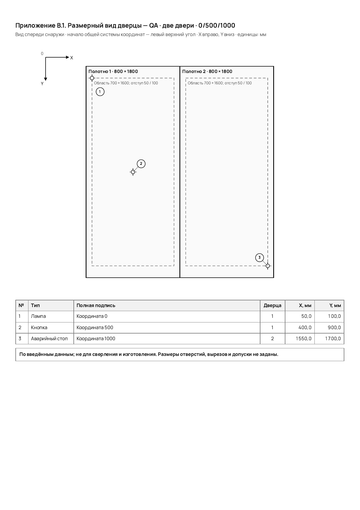
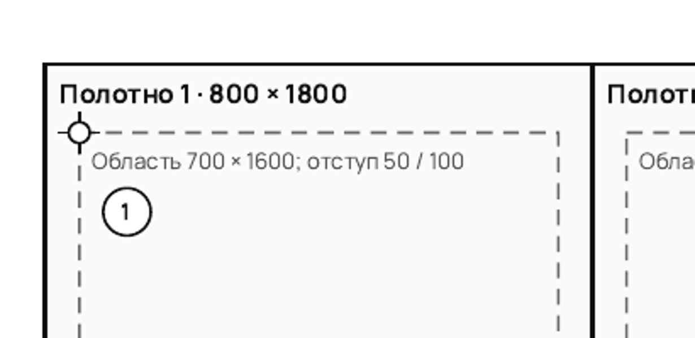

# Компоновка и размерный вид дверцы

Инструкция относится к компоновке `cabinet-door-layout-v1` и размерному виду
`cabinet-door-geometry-v1`. Размеры и координаты в примере демонстрационные.

## Сохранить элементы на дверце

Откройте проект и перейдите в **Структура и состав**. У нужного шкафа откройте
**Редактировать компоновку дверцы**. Выберите одно или два полотна, добавьте
элементы, укажите подписи и переместите их на нужную дверцу. После сохранения
компоновка остаётся в проекте и его новых версиях. При переходе с двух полотен
на одно сначала перенесите элементы со второго полотна.

## Ввести физические размеры

У того же шкафа нажмите **Ввести размеры дверцы**. Для каждого полотна задайте
положение его левого верхнего угла, ширину и высоту в миллиметрах. Затем задайте
отступы и размер области размещения элементов внутри полотна. Число полотен
должно совпадать с сохранённой компоновкой. Программа не выводит размеры из
типа шкафа или названия элемента: используйте проверенные исходные данные.

Для повторения демонстрационного примера: первое полотно начинается в точке
0/0 и имеет размер 800 × 1800 мм; область размещения отстоит на 50 мм слева и
100 мм сверху, её размер — 700 × 1600 мм. Второе полотно начинается в точке
800/0 и имеет такой же размер и область размещения. Сохраните размеры, затем
при необходимости создайте версию проекта. Восстановление версии возвращает
сохранённую в ней компоновку и геометрию.

## Проверить и напечатать размерный вид

Откройте **Документ ТКП** и включите **Приложение В · размерные виды дверей**.
Если для какого-либо шкафа нет компоновки или размеров либо число полотен не
совпадает, документ назовёт шкаф и причину; заполните данные до печати.

На листе показан вид спереди снаружи: X направлена вправо, Y — вниз. Размеры
полотен и областей размещения указаны в миллиметрах. Номера на виде
соответствуют строкам таблицы с типом, полной подписью, номером дверцы и
координатами центра X/Y. Например, элемент в начале области первого полотна
имеет координаты 50,0/100,0 мм. Откройте **Печать / PDF**, выберите A4 и
проверьте лист перед сохранением.

Ниже показан фактический лист A4 из демонстрационного PDF, проверенного на
версии `178fc315` (две дверцы, элементы в точках 0/500/1000). Лист содержит
оси, размеры, маркеры центров и таблицу координат.

На увеличенном фрагменте видно, что маркер начала области размещения и его
номер не закрывают заголовок полотна или подпись размеров.

Размерный вид построен **по введённым данным; он не предназначен для сверления
и изготовления**. Диаметры отверстий, вырезы и допуски в нём не заданы. Экспорт
Word для этого листа не заявлен готовым.

Иллюстрации получены из реального двухстраничного A4 PDF с демонстрационными
данными; первая страница содержит основной документ, вторая — размерный лист.
Скриншоты экранного редактора в этой инструкции отсутствуют: текущий браузер
показывает его, но блокирует сохранение снимка в файл.

## Проверить данные после ошибки

Если сохранение вернуло ошибку, исправьте указанное поле и повторите действие.
При смене компоновки с одной дверцы на две сначала сохраните новую компоновку,
затем введите размеры обеих дверец. До этого печать размерного листа недоступна:
несовпадение числа полотен не заменяется придуманными размерами.
